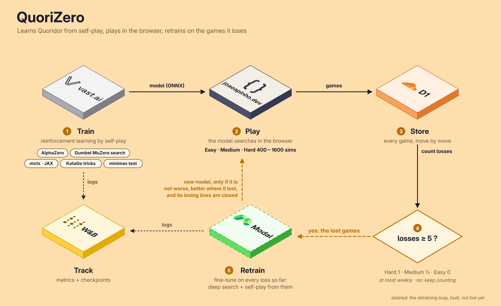
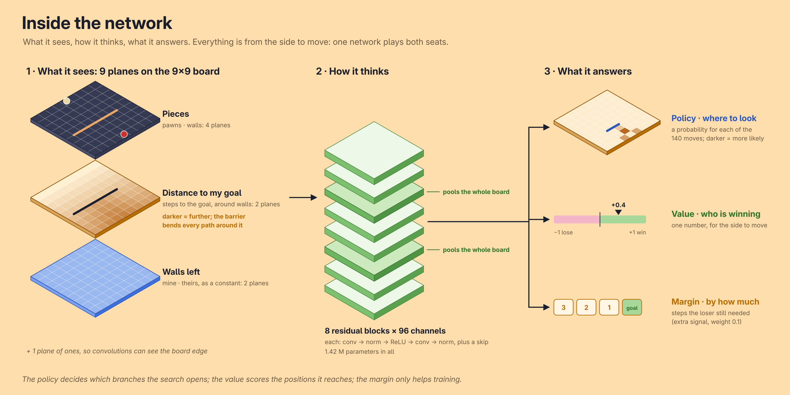
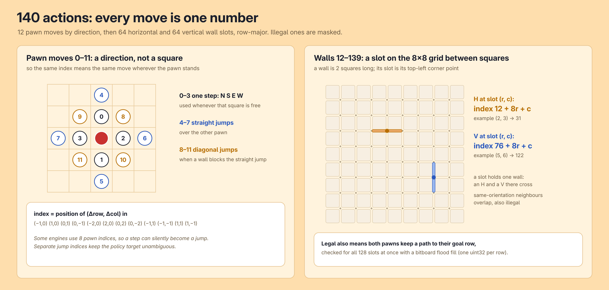
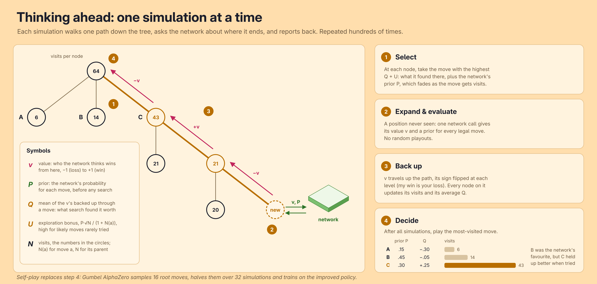
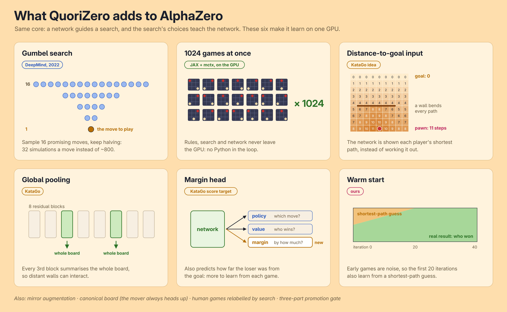
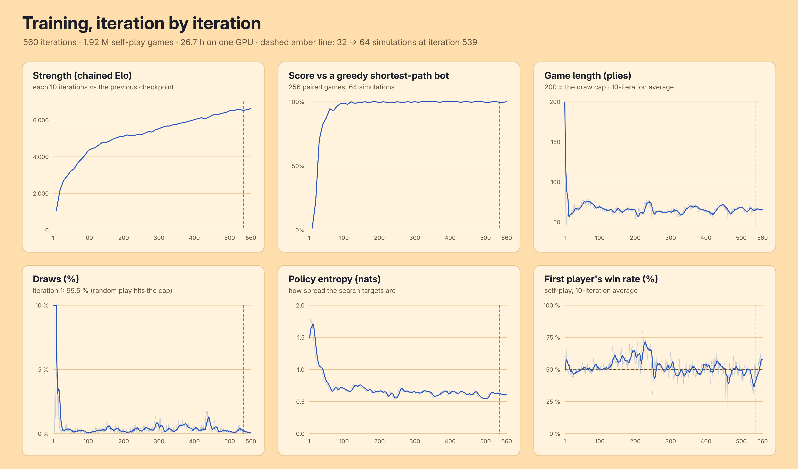

<p align="center">
  
</p>

<h1 align="left">QuoriZero</h1>
<h3 align="left">A Quoridor agent that learned from self-play, plays in the browser and retrains on the games it loses.</h3>

<p align="left">
  
  
  
  
  
  
  
  
  
  
</p>

*#1 strongest publicly available Quoridor model.*

## Abstract/TLDR

Quoridor is a race with walls - each move, a player sets up a wall or steps their pawn, which may extend the opponent's route but never closes it. With up to 140 moves a turn and walls that matter far across the board, it rewards planning more than brute force.

With **Gumbel AlphaZero**, QuoriZero learns it solely through self-play and the rules. Rules, search and network all run on one GPU in JAX, 1,024 games at a time. The trained network runs **in the player's browser**, and the games it loses can trigger a **gated retrain** that redeploys the site by itself.

**Key Results**

- **vs gorisanson's Quoridor AI:** 98% over 100 games (98 wins, 0 draws, 2 losses), **+676 Elo** (95% CI above +521), our 64 simulations against its Strong level of 60,000 rollouts per move.
- **vs SigmaQuoridor:** 77% over 100 games (74 wins, 6 draws, 20 losses), **+210 Elo** [+137, +305] at 64 simulations each.
- **vs Qudor AI:** 61% over 100 games (61 wins, 0 draws, 39 losses), **+78 Elo** [+10, +152] at 64 simulations each.
- **Training:** 560 iterations, 1.92M self-play games and 26.7 GPU hours, for $11 of rented compute.

<p align="center">
  🖱️<a href="https://joaoapinho.dev/quoridor/">Take on the challenge</a>
</p>

---

## Scope

<p align="center"></p>

| Part | What it does |
|---|---|
| Train | Gumbel AlphaZero self-play on a rented GPU (Vast.ai). |
| Track | Weights & Biases logs self-play, training and evaluation metrics, and backs up the run's checkpoints as versioned artifacts. |
| Play | The network, exported to ONNX, searches in a Web Worker on the player's device: Easy (raw policy + 20% random pawn move), Medium (16 to 256 simulations), Hard (400 to 1,600). |
| Store | A Cloudflare Worker keeps every game, move by move, in D1. |
| Retrain | A daily Modal job retrains on the games it lost once enough pile up, and redeploys the page if the new model passes the gate. |

---

## How it works

### 1. The network

<p align="center"></p>

The board is always shown **from the side to move**, flipped so that player's goal is row 0: one network plays both seats without learning the game twice. The two distance planes are a breadth-first search from every square to each goal row, through the walls,

```math
D_p(r, c) = \frac{\min\big(\text{steps from } (r, c) \text{ to row } g_p,\ 32\big)}{16}
```

which hands the network the quantity Quoridor is about instead of making it derive shortest paths from raw walls. Outputs: 140 policy logits, a value $v \in [-1, 1]$ for the side to move, and a margin $m$.

### 2. The action space

<p align="center"></p>

| Action index $a$ (0 to 139) | Meaning |
|---|---|
| $0$ to $11$ | pawn move, by direction $(\Delta r, \Delta c)$ |
| $12 + 8r + c$ | horizontal wall at slot $(r, c)$ |
| $76 + 8r + c$ | vertical wall at slot $(r, c)$ |

Pawn moves are encoded as directions rather than destination squares, so each index represents the same move regardless of the pawn's position. Straight and diagonal jumps get their own indices instead of reusing a step, so a policy target never mixes a step with a jump. The board is flipped for player 0 to align with the mover's perspective, and the policy is permuted accordingly. A wall is legal if its slot is free, it neither crosses nor overlaps another wall, and both pawns keep a path to their goal. These conditions are verified through 128 path checks per position, using bitboard flood fills with one `uint32` per row.

### 3. The search

<p align="center"></p>

**Play (website, evaluation): PUCT** (predictor upper confidence bound applied to trees), as in AlphaZero. Each simulation walks down the tree, at every node taking the move with the highest

```math
\bar{Q}(a) \;+\; c \cdot P(a)\,\frac{\sqrt{N}}{1 + N(a)}
```

The first term is what search found, the second a curiosity bonus $U$:

- $\bar{Q}(a)$: the average result of the simulations through move $a$, rescaled to $[0, 1]$ among the node's moves.
- $P(a)$: the network's prior, how likely it thinks $a$ is the best move.
- $N(a)$, $N$: visits to the move and to the node. Curiosity is high for a likely move tried little, and fades as it gets visits.
- $c$: how much to explore, 1.25 and growing very slowly with $N$ (AlphaZero's $c_1 + \log\frac{N + c_2 + 1}{c_2}$ with $c_1 = 1.25$, $c_2 = 19652$; at most 1.33 here).

With no root noise, it then plays the most-visited move. The browser runs the same algorithm in JavaScript.

**Self-play: Gumbel AlphaZero** (Danihelka et al., 2022). It draws 16 candidate moves at the root, the network's favourites plus a little Gumbel noise so others sometimes get in, and splits only **32 simulations** among them by sequential halving: try them all, drop the worse half, repeat. It trains towards the improved policy

```math
\pi' = \mathrm{softmax}\big(\text{logits} + \sigma(\hat{q})\big), \qquad
\sigma(\hat{q}) = 0.1 \cdot \big(50 + \max_b N(b)\big) \cdot \hat{q}
```

- $\text{logits}$: the network's raw score for each move, its opinion before searching.
- $\hat{q}$: what the search found each move worth; a move it never tried gets the network's value instead.
- $\sigma(\hat{q})$: that finding as a bonus, larger the more the search visited ($\max_b N(b)$ is the top move's visits). The constants are mctx's defaults.
- $\text{softmax}$: turns scores into probabilities that add up to 1.

In short, the new opinion is the old one corrected by what search found. PUCT needs hundreds of simulations for a reliable target Gumbel's is an improvement even at a handful, so self-play stays cheap.

### 4. The training objective

Every position $s$ of a finished game becomes a training example with three answers to learn, one per head:

```math
\mathcal{L} \;=\; -\sum_a \pi'(a) \log p(a \mid s)
\;+\; \big(v(s) - \tilde{z}\big)^2
\;+\; 0.1\,\big(m(s) - \tfrac{\mu}{10}\big)^2
```

The three terms train the three heads: the policy to pick the moves search picked, the value to predict who wins, and the margin to predict by how much.

- $p(a \mid s)$, $v(s)$, $m(s)$: the network's three outputs, move probabilities, value in $[-1, 1]$ and margin.
- $\pi'$: the improved policy from the search above.
- $\mu$: how far the loser still was from their goal at the end, positive if the mover won. It's divided by 10 to be on the same scale, and weighted 0.1 because it is only a helper task.
- $\tilde{z}$: the value target, the game's result with training wheels at the start:

```math
\tilde{z} = (1 - \lambda)\,z + \lambda \tanh\!\Big(\frac{d_{\text{opp}} - d_{\text{me}}}{2}\Big)
```

- $z$: the result for the mover, $+1$ win, $-1$ loss, $0$ draw.
- $\tanh\big(\frac{d_{\text{opp}} - d_{\text{me}}}{2}\big)$: a simple hint, who is closer to their goal ($d$ is the shortest path), squeezed into $[-1, 1]$.
- $\lambda$: how much to trust the hint, 0.5 at the first iteration and fading to 0 by the 21st. Early random games are mostly noise, so the hint gets learning started; then only real results count.

AdamW with weight decay $10^{-4}$, batch 1,024. Each position is also seen **left-right mirrored**, a true symmetry of Quoridor, at no cost.

### 5. What it adds to AlphaZero

<p align="center"></p>

---

## Training

<p align="center"></p>

| | |
|---|---|
| Hardware | NVIDIA GeForce RTX 4090 on Vast.ai (iteration 1 on a laptop RTX 3070) |
| Compute | 26.7 h: 20.4 h self-play, 6.3 h training and evaluation |
| Cost | $11.23 |
| Iterations | 560, each 1,024 games × 256 moves of self-play, then training |
| Volume | 1.92M games, 125.7M positions, 245k gradient steps |
| Self-play speed | ~103,000 games/hour at 32 simulations |
| Replay buffer | the latest 1.5M positions, each seen about twice |
| Network | 8 blocks × 96 channels, 1.42M parameters |

**What the curves show**

- **Random play draws, then it stops |** The first iteration hits the 200-move draw cap in 99.5% of games; by iteration 40 draws are under 1% and games settle at 60 to 70 moves.
- **Basic play is learned fast |** It beats a greedy shortest-path bot in 0% of games at iteration 10 and 100% from about iteration 150.
- **Then refinement |** The policy entropy falls from 1.75 to about 0.6, and every evaluation still beats the previous checkpoint more often than not, so the chained Elo keeps rising.
- **The first move barely matters |** The first player wins 52% on average, but it swings between 22% and 80% as one strategy takes over and the other side finds its counter.

## Learning from players

Every finished game is stored. A loss counts by level, $w = 1$ on Hard and in the challenge, $\tfrac12$ on Medium and $0$ on Easy, and a retrain is due when

```math
\sum_{\text{losses since the last retrain}} w \;\ge\; 5 \quad\text{and a week has passed.}
```

It searches every position of every loss so far at 800 simulations (MuZero Reanalyze: targets come from search, never from the moves played), seeds self-play from the **critical positions** where search and network disagree most, and fine-tunes on 25% lost positions, 25% seeded self-play and 50% regular self-play. The new model goes live only if, against the model that lost:

1. it is **not worse**: at least 50% over 400 paired games from random openings;
2. it is **better where it lost**: at least 55% from the new critical positions;
3. its **losing lines are closed**: in every new loss, it now plays differently somewhere.

---

## Results

Games come in pairs, the same random opening with seats swapped, so neither luck nor the first move decides. Against other engines both networks play through the **same PUCT search** with the same budget on the same rules engine, so the result compares the networks. gorisanson's AI has no network: it plays its own MCTS with hand-written heuristics, at its website's Strong level. A score $s$ over $n$ games is reported as an Elo gap with a 95% interval:

```math
\Delta\text{Elo} = 400 \log_{10}\frac{s}{1 - s}, \qquad
s \pm 1.96\sqrt{\frac{s(1 - s)}{n}}
```

- $s$: QuoriZero's score, the share of points it took, a win counting 1 and a draw ½. At 0.5 the two are even, so $\Delta\text{Elo} = 0$.
- $n$: the number of games played.
- $\Delta\text{Elo}$: how much stronger QuoriZero is. A gap of +200 means it is expected to score about 76%.
- $s \pm 1.96\sqrt{\cdot}$: the range the true score is in with 95% confidence, turned into Elo with the same formula. More games give a narrower range.

| Opponent | Games | Simulations | Score | Elo gap (95% CI) |
|---|---|---|---|---|
| [SigmaQuoridor](https://github.com/bartolomeo3000/SigmaQuoridor) | 100 | 64 | 77% (74W 6D 20L) | +210 [+137, +305] |
| [Qudor AI](https://github.com/ktoto1300/Qudor-AI) | 100 | 64 | 61% (61W 0D 39L) | +78 [+10, +152] |
| [gorisanson's Quoridor AI](https://github.com/gorisanson/quoridor-ai) (Strong) | 100 | 64 vs 60k rollouts | 98% (98W 0D 2L) | +676 [+521, ∞) |
| Greedy shortest-path bot | 256 | 64 | 100% | above +850 |

---

## Conclusions and limitations

**Conclusions**

- **Self-play throughput is the lever |** Putting rules, search and network on the GPU together made a full AlphaZero run fit in about a day on one rented card.
- **Gumbel search makes a low simulation budget enough |** 32 simulations per move produced the training targets for the whole run.
- **Telling the network about distances pays |** Distance planes, global pooling and the margin head target the long-range structure walls create.
- **A model can keep improving after launch safely |** Retraining is triggered by real losses and promoted only through a gate that checks both general strength and the specific weaknesses found.

**Limitations**

- **Chained Elo is relative |** Each checkpoint is compared with the previous one, so the curve shows steady progress but inflates the absolute number - only the external results above are comparable.
- **The engine is deterministic |** Without root noise, a line that beats it once beats it every time until a retrain closes it.
- **Few human games so far |** Retraining from players is built and tested, but has not yet had real losses to learn from.
- **One run, one seed |** No ablations: the contribution of each addition has not been measured separately.

---

## Run locally

Python 3.11 and, for training, an NVIDIA GPU with CUDA 12.

```bash
# 1. Environment.
git clone https://github.com/joaoaapinho/quorizero && cd quorizero
python -m venv .venv && source .venv/bin/activate
pip install -e ".[ml,dev]"
pip install "jax[cuda12]==0.10.2"     # only on an NVIDIA GPU

# 2. Test the rules, search, training and the browser port.
pytest

# 3. Train: a 2-minute smoke run, or a real run on a rented GPU.
python -m train.run --name smoke --lanes 32 --steps 24 --sims 8 --iterations 2
WANDB_API_KEY=... bash scripts/train_cloud.sh

# 4. Benchmark a checkpoint against the greedy and minimax bots (Elo, 95% CI).
python -m evaluation.run_eval runs/smoke/latest

# 5. Export it to ONNX for the page (checks ONNX against JAX).
python -m model.export runs/smoke/latest frontend/model

# 6. Play it at http://localhost:8000.
python -m http.server -d frontend
```

| Folder | Contents |
|---|---|
| `src/` | rules (Python and JAX), search, network, self-play, training, evaluation, retraining |
| `frontend/` | the page, with the rules and search ported to JavaScript |
| `worker/` | the games API (Cloudflare Worker + D1) |
| `infra/` | the retraining job on Modal |

---

## References

**Articles**

- Silver et al., Mastering the game of Go without human knowledge, Nature 2017 (AlphaGo Zero) - [doi.org/10.1038/nature24270](https://doi.org/10.1038/nature24270)
- Silver et al., A general reinforcement learning algorithm that masters chess, shogi, and Go through self-play, Science 2018 (AlphaZero) - [arxiv.org/abs/1712.01815](https://arxiv.org/abs/1712.01815)
- Schrittwieser et al., Mastering Atari, Go, chess and shogi by planning with a learned model, Nature 2020 (MuZero) - [arxiv.org/abs/1911.08265](https://arxiv.org/abs/1911.08265)
- Danihelka, Guez, Schrittwieser and Silver, Policy improvement by planning with Gumbel, ICLR 2022 - [openreview.net/forum?id=bERaNdoegnO](https://openreview.net/forum?id=bERaNdoegnO)
- Karnin, Koren and Somekh, Almost optimal exploration in multi-armed bandits, ICML 2013 (sequential halving) - [proceedings.mlr.press/v28/karnin13.html](https://proceedings.mlr.press/v28/karnin13.html)
- Wu, Accelerating self-play learning in Go (2019) (KataGo) - [arxiv.org/abs/1902.10565](https://arxiv.org/abs/1902.10565)
- Koyamada et al., Pgx: hardware-accelerated parallel game simulators for reinforcement learning, NeurIPS 2023 - [arxiv.org/abs/2303.17503](https://arxiv.org/abs/2303.17503)
- He, Zhang, Ren and Sun, Deep residual learning for image recognition, CVPR 2016 - [arxiv.org/abs/1512.03385](https://arxiv.org/abs/1512.03385)
- Loshchilov and Hutter, Decoupled weight decay regularization, ICLR 2019 (AdamW) - [arxiv.org/abs/1711.05101](https://arxiv.org/abs/1711.05101)

**Quoridor**

- Gigamic, Quoridor rules (2016) - [export.gigamic.com/wp-content/uploads/2021/01/INS-RULES-QUORIDOR_10-2016.pdf](https://export.gigamic.com/wp-content/uploads/2021/01/INS-RULES-QUORIDOR_10-2016.pdf)

**Code and videos**

- Google DeepMind, mctx: Monte Carlo tree search in JAX - [github.com/google-deepmind/mctx](https://github.com/google-deepmind/mctx)
- Förster, AlphaZero from scratch, freeCodeCamp (video course) - [freecodecamp.org/news/code-alphazero-machine-learning-algorithm](https://www.freecodecamp.org/news/code-alphazero-machine-learning-algorithm/)
- Silver, Reinforcement learning course, UCL (lecture videos) - [davidsilver.uk/teaching](https://www.davidsilver.uk/teaching/)
- Kohs, AlphaGo - The Movie (2017) - [youtube.com/watch?v=WXuK6gekU1Y](https://www.youtube.com/watch?v=WXuK6gekU1Y)